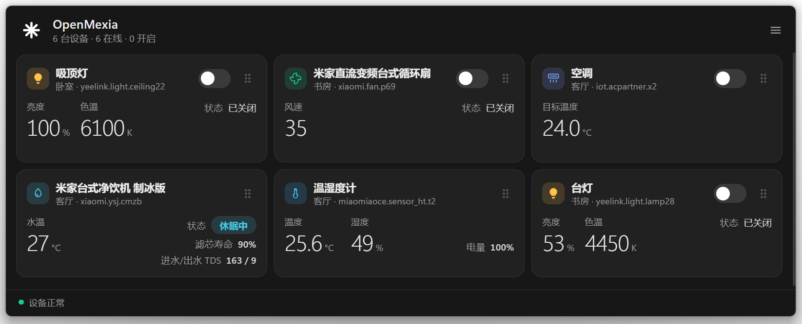
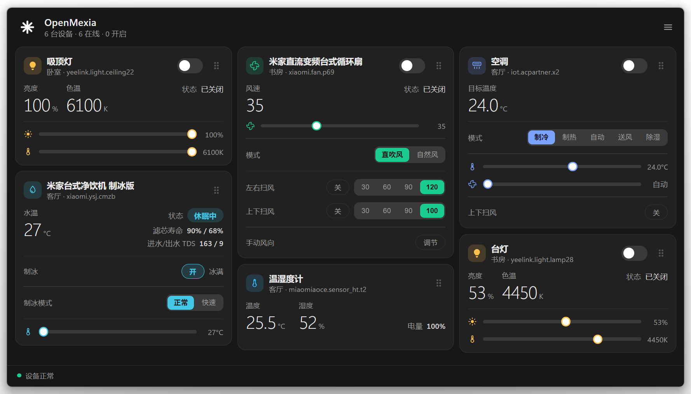
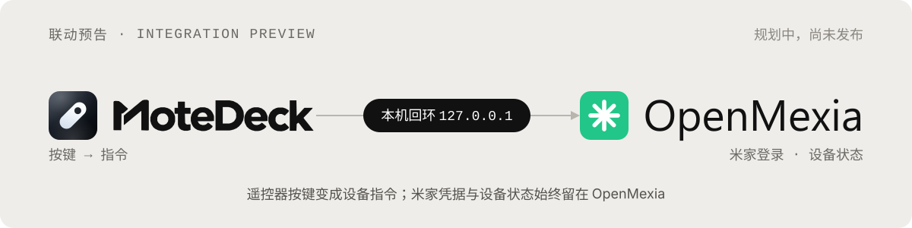

[](https://hzdavy.github.io/OpenMexia/)
#  OpenMexia
[](https://github.com/HZDavy/OpenMexia/releases) [](LICENSE) [](https://github.com/HZDavy/OpenMexia/releases/latest) [](https://github.com/HZDavy/OpenMexia/releases/latest)    [](https://hzdavy.github.io/OpenMexia/)
> 目标是支持所有智能协议。目前支持米家。

OpenMexia 是一个开源、跨平台的智能家居控制中枢。把不同厂商、不同协议（Wi-Fi、蓝牙、Zigbee、Matter 等）的设备，收进一个由你本地掌控的客户端。

Windows 桌面版已发布；macOS、iOS、Android、Linux、鸿蒙在路线图上。各平台共用一套账号与卡片，只做原生适配，不重做体验。

---
## 界面预览





---
## 命名寓意

**OpenMexia** 由 **Open**、**Me**、**X**、**ia** 四个词素构成——开源无界、本地掌控、跨界互联、生态疆域。发音 /miːˈzi.ə/。

---
## 平台支持与路线图

| 平台 | 状态 | 说明 |
|---|---|---|
| Windows 10 / 11（x64） | ✅ 已发布 v0.1.1 | NSIS 安装包，见 [Releases](https://github.com/HZDavy/OpenMexia/releases) |
| macOS | 🚧 规划中 | 桌面端基于 Electron，下一个目标平台 |
| iOS（iPhone / iPad） | 📋 计划中 | 复用同一套设备核心，卡片交互一致 |
| Android（手机 / 平板） | 📋 计划中 | 同 iOS |
| watchOS（Apple Watch） | 📋 计划中 | 腕上控制，复用同一套设备核心 |
| Wear OS（Android 手表） | 📋 计划中 | 腕上控制，同一套设备核心 |
| Linux | 🚧 规划中 | 同样基于 Electron，与 Windows 共用一套代码 |
| 鸿蒙（HarmonyOS） | 📋 计划中 | 面向鸿蒙手机与平板，纳入长期规划 |

### 生态与协议接入

当前版本仅支持米家。目标是支持所有智能协议。其余生态按「开放接口成熟度 + 接入稳定性」逐步评估接入。

| 生态 / 协议 | 状态 | 说明 |
|---|---|---|
| 米家（MIoT） | ✅ 已支持 | 米家账号扫码登录，设备与状态自动同步 |
| Matter | 🚧 计划优先 | 跨厂商通用标准，作为打通各家设备的统一底座 |
| 其他厂商开放接口 | ⏳ 后续评估 | 按是否提供稳定可用的开放 API 依次接入 |

路线进展与讨论见 [GitHub Issues](https://github.com/HZDavy/OpenMexia/issues)，欢迎参与贡献。

---
## Windows 版功能

- 米家账号扫码登录，设备列表与状态自动同步
- 设备卡片瀑布流布局，支持拖动排序、双击（或右键）收折
- 控制项：开关、亮度、色温、风扇风速 / 模式 / 扫风、空调目标温度、净饮机水温等
- 窗口常驻置顶，可拖动缩放，自动记住位置、大小与各项设置
- 系统托盘菜单，支持开机自启
- 两种全屏：普通全屏（任务栏可见）/ 覆盖全屏
- 多显示器：一键发送到副屏
- 网关、温湿度计等不可控设备只展示状态，不显示开关

---

## 联动预告：用实体遥控器控制设备



正在与同作者的 Windows 遥控器工具 [MoteDeck](https://github.com/HZDavy/MoteDeck) 对接：把小米蓝牙语音遥控器 2 Pro（RC003）的按键映射成设备指令，按一下遥控器就能开灯、调亮度或切换模式。

- 分工：MoteDeck 负责按键采集与映射，OpenMexia 负责米家登录、设备状态与控制，两边互不侵入
- 通信：OpenMexia 将提供只绑定 `127.0.0.1` 的本地接口，随机端口 + 每次启动生成的 token，调用方接触不到米家凭据
- 配置：先读取设备与可控项，再由 MoteDeck 选择绑定，OpenMexia 不保存任何按键信息
- 当前状态：规划中，本地控制接口尚未实现；进展见 [Issues](https://github.com/HZDavy/OpenMexia/issues)

---

## 下载安装

到 [Releases](https://github.com/HZDavy/OpenMexia/releases) 下载 `OpenMexia-Setup-x.x.x.exe`，运行后按提示安装，可自选目录。

> **SmartScreen 提示**：本项目为个人开源项目，安装包暂无代码签名证书。首次运行时 Windows 可能弹出「已保护你的电脑」，点击「更多信息」→「仍要运行」即可。软件完全开源，可自行审计源码或从源码构建。

---
## 从源码运行

需要 Node.js 18+。

```bash
npm install
npm start
```

---
## 从源码构建安装包

```bash
npm install
npm run dist
```

产物输出在 `release/` 目录。当前构建脚本仅打包 Windows x64 NSIS 安装包；macOS / Linux / 移动端构建将随对应平台支持一同提供。

---
## 隐私说明

- 米家登录凭据与设备数据仅保存在本机应用数据目录（Electron `userData`），不会上传到米家官方接口以外的任何服务器。
- 项目不内置任何账号、密码或设备 Token。

---
## 免责声明

本项目为个人学习交流用途的非官方软件，与小米 / 米家官方无任何关联，亦未获其授权或背书。所用接口均来自公开开源项目，可能随时变更或失效。使用本软件产生的账号风险与损失由使用者自行承担。请在遵守米家相关服务条款的前提下使用。

---
## License

本项目基于 **GNU AGPL-3.0-or-later** 发布，全文见 [LICENSE](LICENSE)。

之所以采用 AGPL 而非宽松协议，是因为项目依赖 GPL-3.0-or-later 的 [`@zythum02/mijia-api`](https://github.com/zythum/mijia-api)，作为衍生作品须以 GPL 兼容协议分发。你可以自由使用、修改和再分发，但**修改后的版本（包括通过网络提供服务的情形）必须同样以 AGPL 开源并提供完整源码**。

### 第三方开源组件

| 组件 | 许可证 |
|---|---|
| [@zythum02/mijia-api](https://github.com/zythum/mijia-api) | GPL-3.0-or-later |
| [node-mihome](https://github.com/maxinminax/node-mihome) | MIT |
| [qrcode](https://github.com/soldair/node-qrcode) | MIT |
| [Electron](https://github.com/electron/electron) | MIT |
